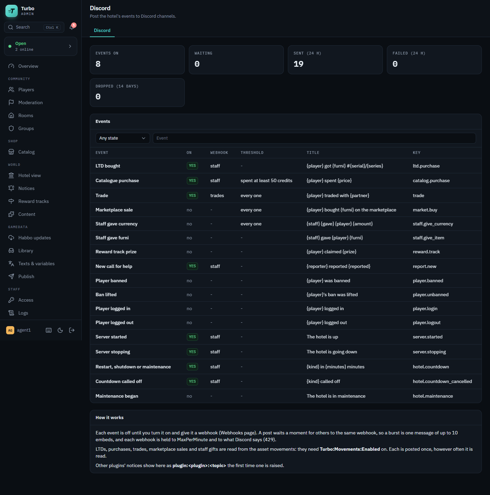
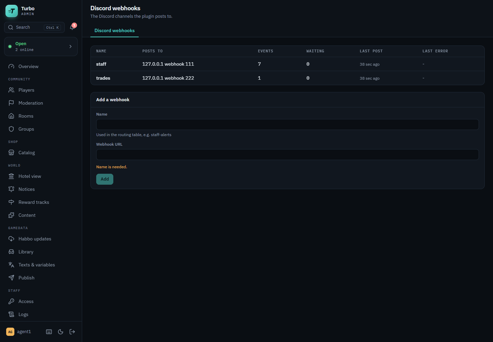
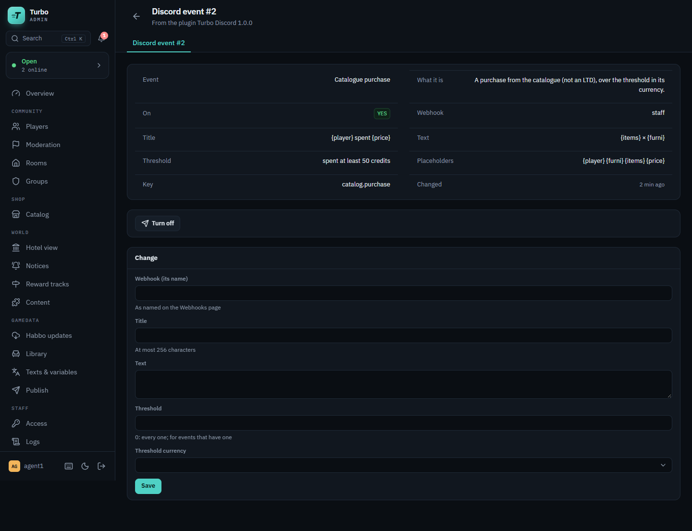
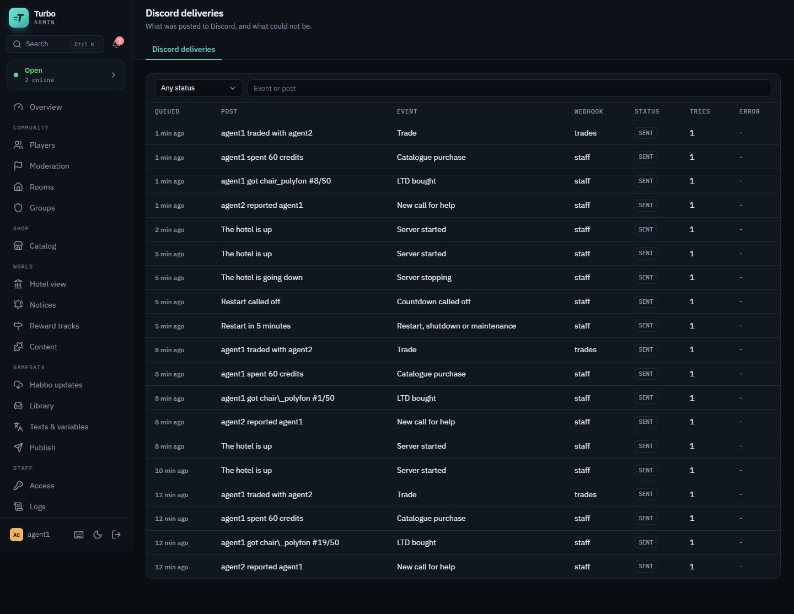

# Turbo Discord plugin

Posts what a hotel owner wants to hear of to Discord channels, for a
[Turbo](https://github.com/nitrodevco/turbo-cloud) hotel: LTDs bought, big purchases, trades,
marketplace sales, staff gifts, new reports, bans, the server starting and stopping, restart and
maintenance countdowns, and the notices other plugins raise. Each event is off until the hotel
turns it on and gives it a webhook on the admin panel's **Discord** page.

- **Webhooks, not a bot.** Add one Discord webhook per channel (staff alerts, trades, a log) by a
  name; route each event to one of them. A webhook's URL holds its token: the panel never shows it
  again, only its host and webhook id.
- **Your words.** Each event has a title and text with placeholders (`{player} got {furni}
  #{serial}/{series}`) that the hotel can rewrite, a colour, fields and a link to the player,
  report or page on the admin panel.
- **Thresholds.** A purchase is posted when it spent at least so much of a currency, a trade when
  it moved at least so many items, a marketplace sale or a `:give` over an amount.
- **Posted once.** An event heard twice (asset movements delivered again, a restart, a plugin
  raising the same notice twice) is posted once.
- **Paced.** A burst to one webhook goes as one message of up to 10 embeds; each webhook is held
  to a number of messages a minute and to what Discord answers (429 and its `retry_after`).
- **Other plugins can post through it**, without a webhook of their own (below).



## Events

| Event | Key | Read from | Placeholders | Threshold |
| --- | --- | --- | --- | --- |
| LTD bought | `ltd.purchase` | asset movements (`catalog.ltd_raffle`) | `{player}` `{furni}` `{serial}` `{series}` `{price}` | |
| Catalogue purchase | `catalog.purchase` | asset movements | `{player}` `{furni}` `{items}` `{price}` | spent, in a currency (credits by default) |
| Trade | `trade` | asset movements | `{player}` `{partner}` `{given}` `{received}` `{items}` | items in the trade |
| Marketplace sale | `market.buy` | asset movements | `{player}` `{seller}` `{furni}` `{price}` | price, in a currency |
| Staff gave currency | `staff.give_currency` | asset movements (`:give`) | `{staff}` `{gave}` `{player}` `{amount}` | amount, in a currency |
| Staff gave furni | `staff.give_item` | asset movements (`:giveitem`, `:gift`) | `{staff}` `{player}` `{furni}` `{items}` | |
| Reward track prize | `reward.track` | asset movements | `{player}` `{prize}` | |
| New call for help | `report.new` | `CallForHelpChangedEvent` | `{reporter}` `{reported}` `{message}` `{category}` `{id}` | |
| Player banned | `player.banned` | `PlayerSanctionChangedEvent` | `{player}` `{reason}` `{by}` `{until}` | |
| Ban lifted | `player.unbanned` | `PlayerSanctionChangedEvent` | `{player}` | |
| Player logged in / out | `player.login`, `player.logout` | `PlayerOnlineChangedEvent` | `{player}` | |
| Server started / stopping | `server.started`, `server.stopping` | the host's lifetime | | |
| Restart, shutdown or maintenance | `hotel.countdown` | the hotel's availability | `{kind}` `{minutes}` `{reason}` `{at}` | |
| Countdown called off | `hotel.countdown_cancelled` | the hotel's availability | `{kind}` | |
| Maintenance began | `hotel.maintenance` | the hotel's availability | `{reason}` | |
| A plugin's notice | `plugin:<plugin>:<topic>` | `PluginNoticeEvent` | `{title}` `{text}` `{source}` `{topic}` | |

- Events from **asset movements** need `Turbo:Movements:Enabled` on (turbo-cloud's
  `docs/movements.md`); the page says so when it is off. The plugin reads the outbox only while
  one of them is on. A purchase, trade or sale is one event per operation; its refund is not an
  event, nor is a trade's compensation. An LTD is not also a catalogue purchase.
- A **report** is posted when it is new: open and less than two minutes old (the same event is
  raised when a moderator picks, releases or closes one).
- **Server started** is the server's start, not a reload of the plugin. **Server stopping** is
  posted before the process ends (it waits up to six seconds for Discord); a killed process posts
  nothing.
- An event older than `MaxEventAgeMinutes` when the plugin hears of it (it was off, or far behind)
  is not news and is not posted.

## Posting from another plugin

Plugins load in load contexts of their own, so they share only the host's types. turbo-cloud's
`PluginNoticeEvent` (`Turbo.Primitives/Plugins/Events`, `docs/plugin-notices.md`) is that shared
type: a plugin publishes one on the hotel's event system, and this plugin posts it. Neither
depends on the other: with this plugin not loaded, a notice goes nowhere.

```csharp
// In StartAsync: the host's event system (reference Turbo.Events from turbo-cloud).
_events = services.GetRequiredService<IHostServices>().GetRequiredService<EventSystem>();

// When something happens, after it is saved:
await _events.PublishAsync(
    new PluginNoticeEvent
    {
        Source = "clienterrors",       // your plugin's key
        Topic = "issue.new",           // stable: the hotel routes by it
        Title = $"New client error #{issue.Id}",
        Text = issue.Message,
        Url = $"{panel}/plugin/clienterrors/issue/{issue.Id}",
        Fields = [new("Build", build), new("Players", players.ToString())],
        Level = PluginNoticeLevel.Error, // the embed's colour
        Key = issue.Id.ToString(),      // posted once per key
    },
    ct
);
```

The first notice of a topic adds `plugin:clienterrors:issue.new` to the routing table, off; the
hotel turns it on and gives it a webhook like any other event. A notice's title and text are
posted as they are (escaped), so keep them to what the hotel's staff may read.

## Delivery

Posts wait in `discord_deliveries`, so the queue **survives a restart**: what was waiting goes
once the server is back. It is also **bounded** (`QueueCapacity`): past it the oldest waiting posts
are dropped, marked as such and counted on the page, because when Discord could not be reached for
long what is new matters more than what is old. Events the hotel raises wait in memory for a moment
before they are routed (at most 1000; a full inbox drops its oldest and counts them too).

| Discord answers | The plugin |
| --- | --- |
| 2xx | Marks the posts sent. When Discord says the webhook's bucket is empty (`X-RateLimit-Remaining: 0`), it waits `X-RateLimit-Reset-After` before the next. |
| 429 | Waits its `retry_after` (or `Retry-After`) before posting to that webhook again; the posts stay as they were, no attempt counted. |
| 5xx, a timeout, no connection | Tries again later: 2 s, 4 s, 8 s... up to 10 minutes apart, `MaxAttempts` times in all, then fails it. |
| 400 | Fails it with Discord's message. A message of several embeds is split first, so one bad embed fails alone. |
| 401, 403, 404 | The webhook is gone or its token is wrong: fails its posts and shows the error on the webhook. |

A post is marked sent once Discord answered: a crash in the instant between the two posts it again.
Every post allows no mentions (`allowed_mentions.parse: []`) and its values are escaped, so a
player named `@everyone` or `**x**` pings no one and is shown as written. Failed posts can be sent
again from the Deliveries page. Sent, failed and dropped posts are kept `DeliveryRetentionDays`.

## Settings

Under `Turbo:Discord` in the server's configuration (`appsettings.json`, the environment:
`Turbo__Discord__QueueCapacity=1000`, or the admin panel's Settings page while the plugin is
loaded). A change applies at once.

| Setting | Default | |
| --- | --- | --- |
| `Enabled` | true | Whether anything is posted. Off: nothing is queued, and what is queued waits. |
| `Username` | empty | The name posts are made under; empty: the webhook's own. |
| `AvatarUrl` | empty | A picture (https) posts are made with; empty: the webhook's own. |
| `Footer` | empty | The footer of every post (the hotel's name); empty: none. |
| `QueueCapacity` | 500 | How many posts wait at most, over every webhook; past it the oldest are dropped. |
| `BatchWindowMs` | 2000 | How long a post waits for others to the same webhook, so a burst is one message. |
| `MaxPerMinute` | 20 | The most messages to one webhook in a minute (Discord allows 30 a channel). |
| `MaxAttempts` | 8 | How many times a post that failed is tried in all. |
| `DeliveryRetentionDays` | 14 | How long sent, failed and dropped posts are kept. |
| `MaxEventAgeMinutes` | 15 | An event older than this when heard is not posted. |
| `AllowedHosts` | `discord.com,discordapp.com,ptb.discord.com,canary.discord.com` | The hosts a webhook may post to. Anything else is refused when it is added, so the panel cannot be used to make the server call other addresses. |

When the server has `Turbo:Admin:PanelUrl`, posts link to the player, report or page on the panel.

## Admin pages and permissions

**Discord** (the routing table: each event on or off, its webhook, threshold and title; one event's
page to change them), **Discord webhooks** (add, send a test post, remove) and **Discord
deliveries** (waiting, sent, failed, dropped, with Discord's answer; send a failed one again).

| Node | |
| --- | --- |
| `plugin.discord.view` | See the Discord pages. |
| `plugin.discord.manage` | Turn events on and off, route them, change their titles and thresholds, send a failed post again. |
| `plugin.discord.webhooks` | Add, test and remove webhooks. |

Declared by the plugin (Access in the admin panel lists them while it is loaded); no group holds
them until the hotel grants them, or holds `*`.

## Privacy

Only what an event's title, text and fields say leaves the hotel, and only for events the hotel
turned on: player names, furni names, amounts, a report's message (which its reporter wrote for
the moderators: route `report.new` to a staff channel). No IP address, email or chat log is ever
posted. Webhook URLs are kept in the plugin's table and never shown back.

## Tables

`discord_webhooks`, `discord_routes`, `discord_deliveries` (the queue and its history) and
`discord_cursors` (how far the asset movements were read, written in the same transaction as the
posts made from them). Uninstalling the plugin from the panel drops them.

## Build and install

The plugin builds against a built turbo-cloud checkout (its `Turbo.*` assemblies are the host's and
are never copied into the plugin's folder), one with `PluginNoticeEvent` (turbo-cloud #296):

```sh
TURBO_CLOUD=/path/to/turbo-cloud ./scripts/package.sh
```

That leaves `dist/discord/` with `TurboDiscord.dll`, `TurboDiscord.xml` (the settings' descriptions
on the panel) and `manifest.json`. Copy that folder into the server's plugin folder
(`Turbo:Plugin:PluginFolderPath`, by default `plugins/` beside `Turbo.Main`), as `plugins/discord/`,
and restart the server (or let hot reload pick it up). On load the plugin creates its tables
through the server's own migrator, so the server's `Turbo:Database:Migrate` setting applies to them
as to core's tables.

### Releases

A tag `v1.2.3` (pushed, or named in a manual run of Release, which makes it on that commit) runs
`.github/workflows/release.yml`: it builds and tests the plugin against turbo-cloud at the ref
pinned there (`TURBO_CLOUD_REF`), stamps the manifest's `Version` (1.2.3) and `BuiltAgainst` (that
ref), and attaches `discord-v1.2.3.zip` to the tag's release. A server linked to this repository in
the admin panel (Plugins, Link from GitHub) is offered the release and installs the zip.
`ApiVersion` in the manifest is the turbo-cloud plugin API it is built for
(`Turbo.Contracts.Plugins.PluginApi`); move `TURBO_CLOUD_REF` and it together when turbo-cloud
changes that.

## Tests

```sh
dotnet test TurboDiscord.Tests -p:TurboCloudPath=/path/to/turbo-cloud
dotnet tool restore && dotnet csharpier check .
```

Routing, thresholds, dedupe, templates and escaping, the queue's bound, the events read from asset
movements, batching, the 429 and backoff handling, the admin endpoints, and the hotel's events and
plugin notices, over an in-memory SQLite database and a fake Discord. `.github/workflows/ci.yml`
runs both on every push and pull request against turbo-cloud's `main`.

## Migrations

```sh
TurboCloudPath=/path/to/turbo-cloud DesignTime=true dotnet ef migrations add <Name> \
  --project TurboDiscord/TurboDiscord.csproj --context DiscordDbContext --output-dir Database/Migrations
```

## Screens

| | |
| --- | --- |
|  |  |
| The webhooks: where each posts to (never its token), its events, what waits, its last post and error. | One event: its title, text, threshold and placeholders, and the form to change them. |
|  | |
| What was posted, and what could not be. | |
